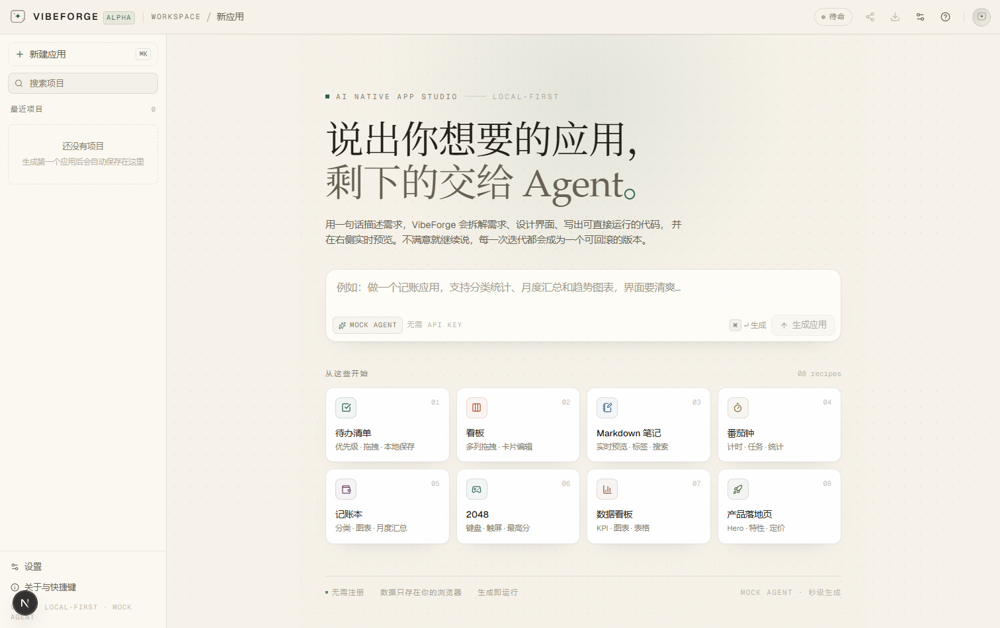
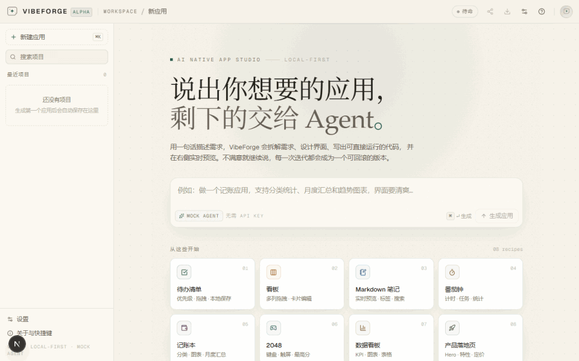

# VibeForge

> 说出你想要的应用，剩下的交给 Agent。
>
> 一个 Atoms 风格的 **AI 原生应用生成器**：自然语言 → 可运行、可交互、可回滚的网页应用。
>
> 🌐 **在线体验**：https://vibeforge-interview-demo.netlify.app （静态部署，Mock Agent 在浏览器内运行，无需登录/无需 Key）
>
> 📄 提交用简要说明（实现思路 / 完成度 / 扩展优先级）见 [`说明文档.md`](说明文档.md)。
>
> 📘 不会用？看 [`操作手册.md`](操作手册.md)（图文版，3 分钟上手：生成 → 试玩 → 迭代 → 分享）。





## 这是什么

VibeForge 复刻的是「AI Agent 驱动生成应用」的核心体验：

1. 用一句话描述你想要的应用（中文）；
2. Agent 流式工作：拆解需求 → 输出实施计划 → 逐个文件写出 `index.html / styles.css / app.js` → 自检；
3. 生成结果在**沙箱 iframe 里立刻运行**，可直接交互、可刷新、数据持久化；
4. 不满意就继续对话，每次迭代自动存档，可回滚、可分享、可导出。

不需要注册、不需要后端数据库、不依赖任何 CDN —— 应用代码完全离线可运行。

## 快速开始

```bash
# 需要 Node 22+ / pnpm 10+
pnpm install      # 本目录自带 pnpm-workspace.yaml + pnpm-lock.yaml，完全自包含
pnpm dev          # http://localhost:4311
pnpm build        # 生产构建（Vercel 可直接使用）
```

> 默认使用内置 **Mock Agent**（确定性生成器，无需 API Key，秒级返回）。
> 接入真实模型：右上角「设置」→ 选择 OpenAI 兼容 / Anthropic → 填入 Key（只保存在本地浏览器，随请求发给同源代理）。
>
> 👉 第一次使用建议先看 **[操作手册.md](操作手册.md)**（图文步骤：生成 → 试玩 → 迭代 → 代码/版本 → 分享导出）。

## 功能

| 能力 | 说明 |
| --- | --- |
| **账号体系** | 注册 / 登录 / 退出、PBKDF2 加盐密码哈希、服务端会话（Netlify Blobs）；项目按账号隔离，未登录不可进入工作台 |
| 流式生成 | NDJSON 流式接口，逐帧渲染「思考 / 计划 / 写文件 / 自检」 |
| 实时预览 | 多文件项目内联成单文档，注入运行时桥后在沙箱 iframe 运行 |
| 多轮迭代 | 继续对话即可修改；真实模型会带当前文件上下文整体重写，Mock 模式会响应改名/换主题等显式指令 |
| 版本时间线 | 每次生成自动快照，可回滚到任意历史版本，可**逐行 diff 对比**当前版本 |
| 分享链接 | 整个应用压缩编码进 URL hash，打开即运行，无需服务器 |
| 导出 | 单文件 HTML / 项目 JSON |
| 运行时控制台 | 捕获生成应用的 `console` 与未捕获错误，便于定位问题 |
| 本地持久化 | 项目 / 会话 / 版本存 IndexedDB，刷新不丢 |
| 设备预览 | 桌面 / 平板 / 手机三种视口；移动端「对话 / 预览」切换 |
| 生成控制 | 可随时**停止**生成；失败可**重试这一步** |
| **真实 Agent** | 服务端调用真实大模型（OpenAI 兼容 / 百炼 qwen3.8-flash · qwen3.8-max-0902 / Anthropic），结构化 JSON 输出；Netlify Background Function（15 分钟预算）+ 轮询进度；模型不可用时自动降级到内置生成器 |
| **领域生成** | 关键词命中领域配方（如「会议室预约」→ 时间段 + 冲突校验），而非通用条目库 |

## 生成内核

```
prompt ──► router（关键词路由）
             ├─► recipe ×13        # 手写的「精致产品感」应用配方
             └─► synthesizer       # 任意对象型需求的通用 CRUD 合成器
                     │
                     ├─ theme engine   # 关键词 → 调色板（亮色优先）
                     └─ design language# 极简 / 纸感 / 精密仪表 / 软糖卡片
                             ▼
                   3-file app（HTML/CSS/JS）──► SSE/NDJSON ──► 预览
```

- **recipe**：待办、看板、Markdown 笔记、番茄钟、记账、习惯打卡、答题、2048、数据看板、落地页、AI 聊天、计算器、音乐播放器；
- **synthesizer**：书单、追剧、菜谱、健身、旅行、客户、库存、课程、灵感、联系人…… 任意「XX 管理」需求；
- **Mock generation 是确定性的**：同一 prompt 永远得到同一结果，便于测试；真实模型只替换 provider 层。

### 真实 Agent 实测（百炼 · qwen3.8-flash，线上）

线上站点通过 Netlify Background Function 调用真实模型（Key 只存在服务端环境变量），浏览器侧轮询 Blobs 进度。

| 指标 | 结果 |
| --- | --- |
| 首轮生成（会议室预约，任意需求） | **77.9s**（prompt 未预设、模型自行设计领域；生成中持续推送心跳日志） |
| 二轮修改（改标题 + 加冲突校验） | **70.8s**，标题生效、领域逻辑保持 |
| 输出 | 3 文件 / 约 14 KB：`index.html` 2.0KB、`styles.css` 4.8KB、`app.js` 7.4KB |
| 领域正确性 | 生成「会议室 + 时间段 + 冲突校验」应用，代码含 `overlap/conflict` 校验逻辑（非内置配方） |
| 备选模型 | 设置面板可切换 `qwen3.8-max-0902`（更强，约 2 分钟）/ `qwen3.8-flash`（默认，约 1–1.5 分钟） |
| 降级 | 模型不可用（Key 失效/限流）时自动切到内置生成器并在对话中提示，保证演示不中断 |
| 截图 | `shots/real-agent-booking.png` |

复跑：`BASE_URL=https://vibeforge-interview-demo.netlify.app node scripts/verify-real-agent-online.mjs`
（或 `pnpm test:real`），会校验首轮/二轮均真实完成、非内置配方、含冲突校验。

## 技术栈与取舍

- **Next.js 16 App Router + TypeScript + Tailwind v4**：一个仓库同时容纳 UI 与生成接口，Vercel 一键部署；
- **服务端流式生成**（`POST /api/generate`，NDJSON）：模型 Key 不进浏览器代码；逐帧推送让生成过程可感知；
- **本地优先 + 轻量服务端**：项目/版本/会话存浏览器 IndexedDB（Dexie）；账号与会话存 Netlify Blobs（PBKDF2 哈希），不引入数据库；
- **单文件内联预览**：生成的应用不是部署到独立域名，而是把 3 个文件内联进 `iframe srcdoc`；配合注入的运行时桥实现控制台捕获、错误捕获和存储降级；
- **分享 = URL 编码**：gzip + base64url 压缩完整项目进 URL hash（比旧版 lz-string 小 ~33%，兼容旧链接），别人打开即可运行，零后端；
- **真实模型 = 结构化 JSON**：要求模型只输出一个 `{plan, files}` JSON 对象；对推理模型做参数降级重试（temperature/response_format/max_tokens 被拒时自动退让），并推送心跳日志避免长任务看起来卡死；
- **Mock provider 与真实 provider 同构**：都是 `AsyncGenerator<AgentEvent>`，UI 只认事件流。

## 目录结构

```
src/
  app/
    page.tsx                 # 工作台入口
    api/generate/route.ts    # 流式生成接口（NDJSON）
    globals.css              # 设计令牌：paper & ink 亮色主题
  components/
    ui/                      # Button / Dialog / Tooltip / Logo 等基础件
    workspace/               # 工作台组件
      workspace.tsx          #   编排：状态 + 布局（已按职责拆出下面三个模块）
      run-state.ts           #   纯 reducer：Agent 事件 → RunView
      chat.tsx / preview.tsx / versions-pane.tsx / …
  lib/
    agent/
      mock.ts                # Mock Agent：路由 + 叙述 + 流式节拍 + 静态自检
      real.ts                # OpenAI 兼容 / Anthropic 流式接入（结构化 JSON 输出）
      themes.ts              # prompt → 调色板
      recipes/               # 13 个应用配方（每个都是完整可运行应用）
      synth.ts               # 通用 CRUD 合成器
    preview.ts               # 多文件内联 + 运行时桥
    share.ts                 # 分享链接编解码（gzip / lz-string / legacy）
    diff.ts                  # 版本逐行 diff
    workspace-store.ts       # 持久化：Project/Message/Version 事务
    workspace-io.ts          # 导出下载等浏览器 IO
    db.ts                    # Dexie schema
    __tests__/               # Vitest 单元测试（53 个断言）
scripts/
  check-recipe.mjs           # recipe 自动化验收（生成 → 语法 → 渲染 → 截图）
  e2e-flows.mjs              # 端到端主流程测试
  verify-requirements.mjs    # 笔试四项需求覆盖验证
  check-mobile.mjs           # 移动端对话/预览切换 + 溢出检查
  test-real-provider.mjs     # 本地假 SSE 验证真实模型两条协议
  demo-gif.mjs               # 录制演示 GIF
  qa-ui.mjs / shots.mjs      # 布局审计 / 截图回归
shots/                       # 截图与 demo.gif
```

## 部署（Vercel）

项目无服务端数据库、无外部依赖，`pnpm build` 已通过，可直接部署：

```bash
pnpm dlx vercel deploy --prod        # 首次会提示登录 / 关联项目
# 或：在 Vercel 控制台 Import 本目录（Framework: Next.js，Build: pnpm build）
```

### 临时公网链接（无需任何账号，cloudflared 快速隧道）

适合「评委临时点开看」或没有 Vercel 账号时：

```powershell
# 终端 1：生产模式跑在 0.0.0.0（同事/同网设备可访问 http://<本机IP>:4311）
pnpm build
pnpm start:lan

# 终端 2：把本地 4311 暴露到公网（cloudflared 放在 .tools\，不入库）
.\.tools\cloudflared.exe tunnel --url http://localhost:4311 --no-autoupdate
# 输出形如 https://xxx.trycloudflare.com 的公网地址
```

> 注意：链接只在两个进程运行期间有效，关机/关闭终端即失效；重启后地址会变。
> 验证线上可用性：`BASE_URL=https://xxx.trycloudflare.com node scripts/verify-public.mjs`。

### 静态部署 + 服务端函数（Netlify，当前线上方式）

`vercel.app` / `pages.dev` 在部分网络不可达，Netlify 静态托管 + Background Functions 是更稳的方案：

```powershell
pnpm build:static        # 静态导出到 out/（约 1.7MB）
pnpm build:functions     # esbuild 打包 netlify/functions → .netlify-bundle/（依赖内联）
pnpm --package=netlify-cli@latest dlx netlify deploy --dir=out --functions=.netlify-bundle --prod --site <site-id>
```

- **账号**：`/.netlify/functions/auth`（注册/登录/登出，Netlify Blobs 存储，PBKDF2 哈希）
- **真实模型**：`/.netlify/functions/generate-background`（Background Function，15 分钟预算）调用服务端
  `OPENAI_*` 配置的模型，进度写入 Blobs，前端 `/.netlify/functions/poll` 轮询并逐帧渲染；
  模型不可用时前端自动降级为内置生成器。
- 服务端环境变量（Netlify 项目设置 / `netlify env:set`）：

| 变量 | 说明 |
| --- | --- |
| `OPENAI_API_KEY` | 服务端模型 Key（必填，模型才可用） |
| `OPENAI_BASE_URL` | 兼容端点，如 `https://dashscope.aliyuncs.com/compatible-mode/v1` |
| `OPENAI_MODEL` | 默认模型，如 `qwen3.8-flash` |
| `OPENAI_ALLOWED_MODELS` | 允许前端切换的模型（逗号分隔），如 `qwen3.8-flash,qwen3.8-max-0902` |

- 若站点被 Netlify 的 Team protection 拦截（HTTP 401），在站点设置里关闭 SSO 保护即可。

可选环境变量（不配则运行内置 Mock Agent）：

| 变量 | 说明 |
| --- | --- |
| `DEFAULT_PROVIDER` | `mock`（默认）/ `openai` / `anthropic` |
| `OPENAI_API_KEY` / `OPENAI_BASE_URL` / `OPENAI_MODEL` | 服务端默认模型 |
| `ANTHROPIC_API_KEY` / `ANTHROPIC_BASE_URL` / `ANTHROPIC_MODEL` | 服务端默认模型 |

> 也可以让访问者自带 Key（设置面板），Key 只存访问者本地、随请求发给同源代理，不写入代码与分享链接。

## 笔试需求覆盖（自动验证）

笔试要求「真实交互 / 数据持久化 / 基本使用流程 / 至少一个延展能力」。
四项均已满足并有可复跑的自动化证据（`node scripts/verify-requirements.mjs`，报告写入
`docs/需求覆盖验证报告.md`）：

| 要求 | 实现 | 自动验证证据 |
| --- | --- | --- |
| 真实交互（非静态） | 生成过程流式可交互；生成结果在沙箱 iframe 真实运行 | 脚本进入生成的应用：输入+回车新增任务、统计实时更新、筛选 tab 真实过滤 |
| 数据持久化 | 产品：IndexedDB（项目/会话/版本）；生成应用：localStorage（+ 不可用时的内存降级桥） | 刷新 iframe 后新增数据仍在；整页刷新后项目仍在；重开项目代码与数据一并恢复 |
| 基本流程（初始化/主流程） | 空状态初始化 + 8 个起步模板；核心流程 = 输入 → 理解 → 计划 → 写文件 → 自检 → 预览 | 协议断言完整事件序列（understand/design/code/verify + 3 files + done）；流式耗时 5–6s 可感知 |
| 延展能力 | 多轮迭代、版本时间线/回滚、分享链接、导出 HTML/JSON、运行时控制台 | 脚本逐项操作并断言（迭代后版本 +1、回滚生效、分享链接新标签页可直接运行、导出触发下载） |

## 测试

```bash
pnpm typecheck                          # TypeScript（严格模式）
pnpm lint                               # ESLint（flat config，0 warning）
pnpm test                               # Vitest 单元测试（53 个断言：share/format/preview/themes/diff/real 解析）
node scripts/test-real-provider.mjs     # 真实模型接入链路（本地假 SSE，无需 Key）
node scripts/check-recipe.mjs --all     # 全部 13 个 recipe + 合成器验收（生成 → 语法 → 渲染 → 截图）
node scripts/e2e-flows.mjs              # 端到端主流程（生成/迭代/回滚/分享/导出/刷新持久化）
node scripts/verify-requirements.mjs    # 笔试四项需求覆盖验证（真实交互/持久化/主流程/延展）
node scripts/check-mobile.mjs            # 移动端对话/预览切换 + 溢出检查
node scripts/demo-gif.mjs                # 录制演示 GIF（shots/demo.gif）
node scripts/validate-real-app.mjs       # 渲染校验真实模型生成结果（需 shots/real-run.ndjson）
node scripts/qa-ui.mjs / shots.mjs       # 布局审计 / 截图回归
```

当前状态：`typecheck` ✅、`lint` 0 warning ✅、`build` ✅、单元测试 53/53 ✅、
recipe 全量 14/14 PASS ✅、主流程 E2E 11/11 PASS ✅（含取消/重试）、
**笔试四项需求覆盖 4/4 PASS** ✅、移动端切换检查 7/7 PASS ✅、真实模型协议链路 PASS ✅。

## 已知限制

- **Mock 模式不是真的 LLM**：任意 prompt 会路由到最接近的 recipe 或通用合成器，语义理解有上限；
  真实模型模式（BYOK）走同一事件协议，质量由所选模型决定。
- **真实模型较慢**：百炼 qwen3.8-flash 约 1–1.5 分钟、qwen3.8-max-0902 约 2 分钟（会持续推送心跳日志，可随时取消）；
  Mock 模式是秒级，适合评委直接体验。
- **Mock 模式的多轮迭代是「整体重建」**，不是精准 diff 修改；真实模型模式下会把现有文件作为上下文做完整重写。
- 预览 iframe 使用 `allow-same-origin allow-scripts` 以便生成应用使用 `localStorage`；生成代码来自受信任的生成器，若接入真实模型建议改为独立域名沙箱。
- 分享链接经 gzip 后约 7–8KB（base64 有 ~33% 膨胀）；更长的项目建议用「导出 HTML」。

## Roadmap（继续投入的优先级）

1. **真实模型质量**（P0）：接入便宜快模型作为可选默认，配合「生成 → 运行时错误回喂 → 自动修复」闭环；
2. **沙箱独立域**（P0）：生成应用到独立 origin，彻底隔离；
3. **精准增量修改**（P1）：结构化 AST 级 patch，而不是整文件重写；
4. **部署与分享强化**（P1）：一键部署生成的静态站点到用户域名；分享短链服务；
5. **协作**（P2）：项目导入/导出、多人实时预览。
