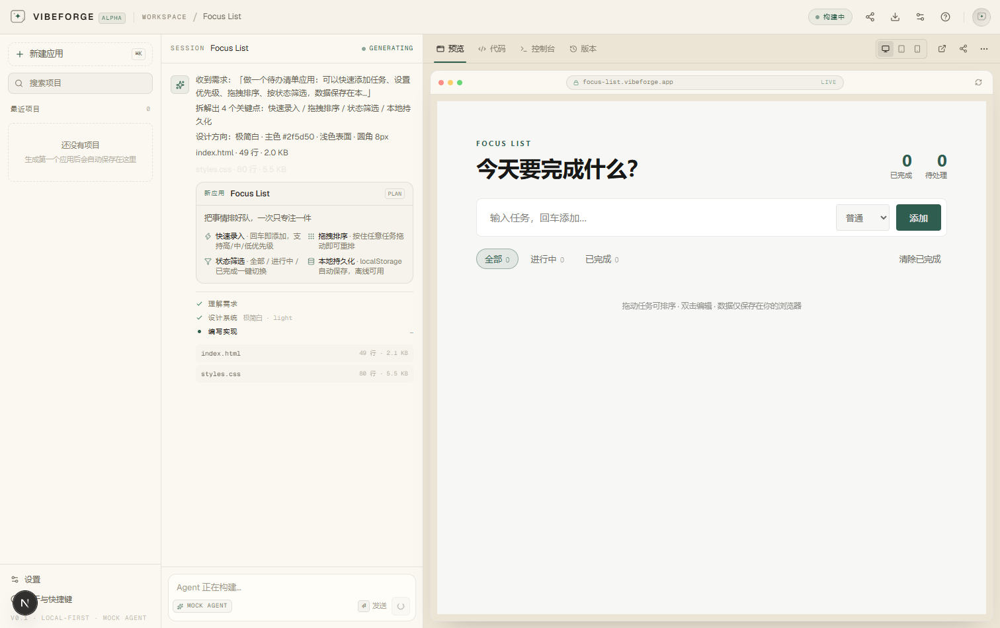
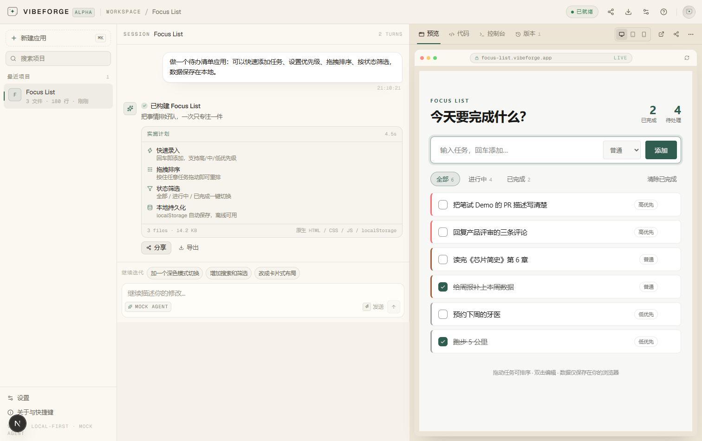
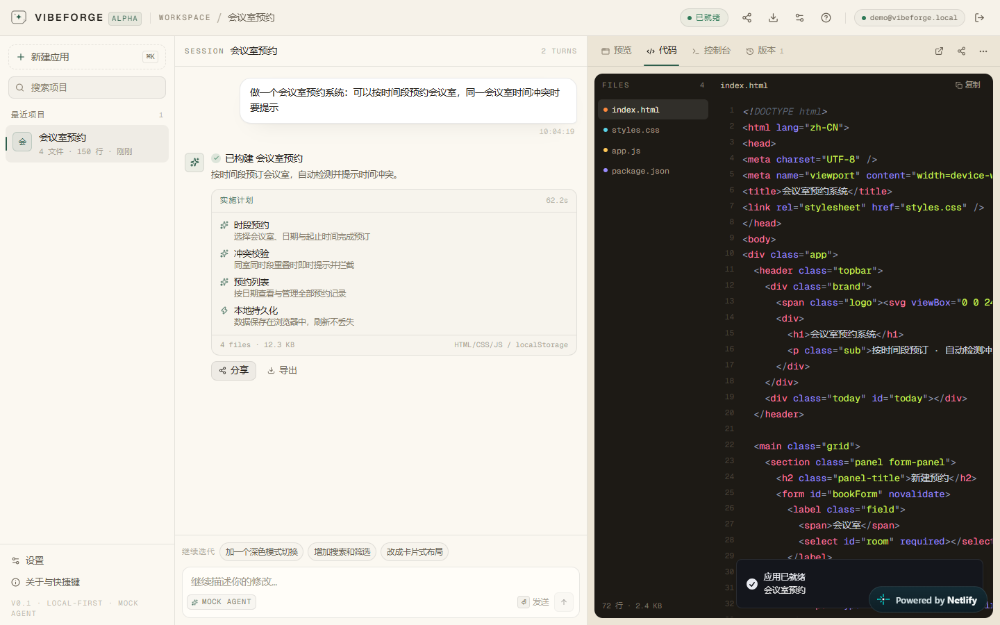
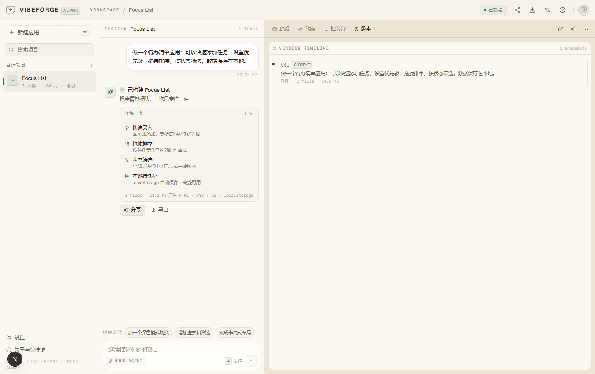
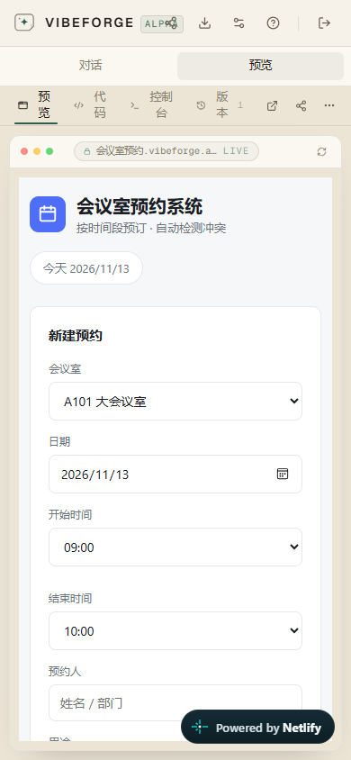

# VibeForge 操作手册（简单版）

> 🌐 在线体验：**https://vibeforge-interview-demo.netlify.app**
> 打开就能用，**不需要注册、不需要 API Key**。整个流程大约 3 分钟。

---

## 0. 你会看到一个怎样的页面

打开链接后是三栏工作台（手机上是上下两块，可切换）：

- **左边**：项目列表（生成过的应用都存这里）
- **中间**：和 Agent 的对话区（描述需求、看它干活）
- **右边**：生成结果（预览 / 代码 / 控制台 / 版本）


---

## 1. 生成第一个应用

有两种方式，任选一种：

**方式 A：点模板（最快）**
1. 首页「从这些开始」区域有 8 个卡片（待办清单、看板、Markdown 笔记、番茄钟、记账、2048、数据看板、落地页）
2. 直接点任意一个卡片 → 立刻开始生成

**方式 B：自己描述**
1. 在中间输入框里写一句话，例如：
   - `做一个记账应用：记录收支、按分类统计、显示月度趋势图`
   - `做一个书单管理：记录书名、作者、评分和阅读状态`
2. 按 **Enter**（或点「生成应用」按钮）

> 提示：描述得越具体（功能、数据、想要的感觉），结果越接近预期。

---

## 2. 看 Agent 干活

生成过程是**流式**的，中间区域会依次出现：

1. 「收到需求」「拆解出 N 个关键点」
2. **实施计划卡**：应用名、一句话卖点、功能点、技术栈
3. **逐个文件写入**：`index.html` → `styles.css` → `app.js`（带行数/体积）
4. **自检**：结构 / 脚本语法 / 体积检查
5. 「已构建 · 应用名」



> 过程中如果不想等了，点输入框右侧的 **「停止」** 可以随时取消；
> 出错时会出现 **「重试这一步」**。

---

## 3. 试玩生成的应用

生成完成后，右侧会自动切到「预览」：

- 可以直接在预览区里**点击、输入、拖拽**（这是真实运行的应用，不是截图）
- 顶部地址栏旁显示 `xxx.vibeforge.app`，右侧有刷新按钮
- 你做的操作会存在浏览器本地，**刷新页面也不会丢**



---

## 4. 继续修改（多轮迭代）

对结果不满意？在中间输入框继续说话即可，例如：

- `加一个深色模式切换`
- `增加搜索和筛选`
- `改成卡片式布局`

Agent 会在原应用基础上重新生成，聊天区也会出现 **「继续迭代」** 的快捷建议。

---

## 5. 查看代码、控制台、版本

右侧顶部有 4 个页签：

| 页签 | 用途 |
| --- | --- |
| **预览** | 试玩生成的应用（默认） |
| **代码** | 看 3 个文件的真实源码，可切换文件、一键复制 |
| **控制台** | 显示生成应用运行时的 `console` 输出和报错，方便排查 |
| **版本** | 每次生成/迭代都会自动存一个快照：可**恢复**到历史版本，也可**对比**当前版本的逐行 diff |





---

## 6. 分享 & 导出

- **分享**：点右上角「分享」图标 → 复制链接 → 发给别人。链接里已经包含完整应用，对方**打开即可运行**（对方浏览器里是独立副本）。
- **导出**：点预览区右上「⋯」或顶部下载图标：
  - `下载 HTML`：得到一个单文件网页，双击就能打开
  - `导出项目 JSON`：保留完整项目数据，便于备份

---

## 7. 管理项目（左侧栏）

| 操作 | 怎么做 |
| --- | --- |
| 新建应用 | 点「新建应用」，或按 **⌘K / Ctrl+K** |
| 打开历史项目 | 直接点左侧项目名 |
| 搜索项目 | 左侧搜索框输入关键词 |
| 删除项目 | 鼠标悬停在项目上 → 点垃圾桶图标（会二次确认） |

所有项目都存在**当前浏览器本地**（IndexedDB），换浏览器/清缓存会看不到，重要项目记得导出 JSON。

---

## 8. 手机 / 平板查看

- 手机上：中间和右侧变成上下两块，顶部有 **「对话 / 预览」** 切换按钮
- 桌面预览区右上角可切换 **桌面 / 平板 / 手机** 三种视口



---

## 9. 设置：Mock Agent 与真实模型（可选）

点右上角 ⚙️ 设置：

- **Mock Agent（默认）**：内置确定性生成器，秒级返回、无需 Key —— **评审/演示用这个即可**
- **真实模型**：可选 OpenAI 兼容（OpenAI / DeepSeek / 百炼 kimi-k3…）或 Anthropic，填自己的 Key
  - Key 只保存在你本地浏览器，不会上传
  - 设置里有「快速填充」预设按钮（百炼 kimi-k3 / DeepSeek / OpenAI / Claude）
  - 真实推理模型较慢（kimi-k3 全量生成约 3 分钟），可随时点「停止」

> 当前线上链接是**静态部署**：Mock 在浏览器内运行；真实模型受浏览器 CORS 限制，完整能力请本地运行。

---

## 10. 常见问题

**Q：打不开 / 白屏？**
A：先刷新一次；若仍不行，换个网络试试（该链接部署在 Netlify，国内一般可直连）。

**Q：生成的应用数据存在哪？**
A：产品数据（项目/版本）在浏览器 IndexedDB；生成应用自己的数据在各自域名的 localStorage。都不上云。

**Q：分享出去的链接为什么那么长？**
A：链接里编码了完整应用代码（已 gzip 压缩）。太长时用「导出 HTML」发文件。

**Q：能生成任意应用吗？**
A：Mock 模式会路由到最接近的内置配方或通用 CRUD 合成器（书单、追剧、菜谱、健身、客户、库存…）；
接入真实模型后则是模型自由发挥。

**Q：怎么在本地跑？**
A：克隆仓库后：

```bash
pnpm install
pnpm dev        # http://localhost:4311
```

---

## 附：本地完整版（含真实模型服务端代理）

```bash
pnpm install
cp .env.example .env.local   # 需要真实模型时填 Key
pnpm dev                     # 开发模式
# 或生产模式：pnpm build && pnpm start
```

本地版额外拥有：服务端真实模型代理（Key 不进前端）、`/api/generate` 流式接口、
以及全部自动化验证脚本（`pnpm test` / `scripts/*.mjs`）。
