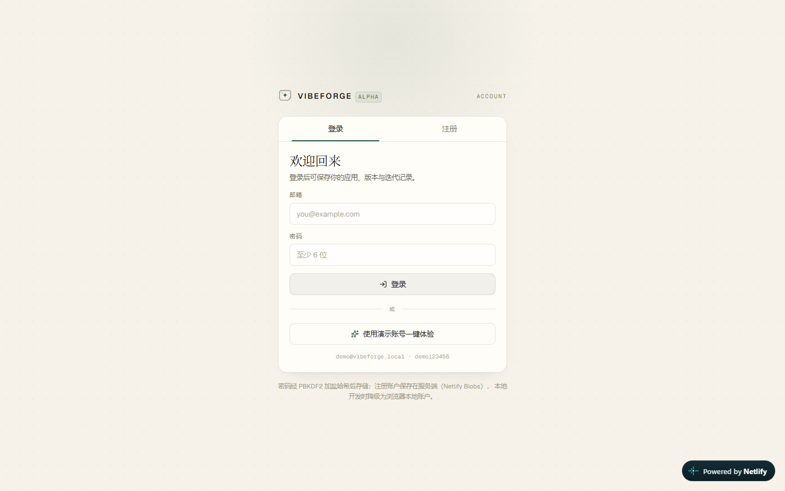
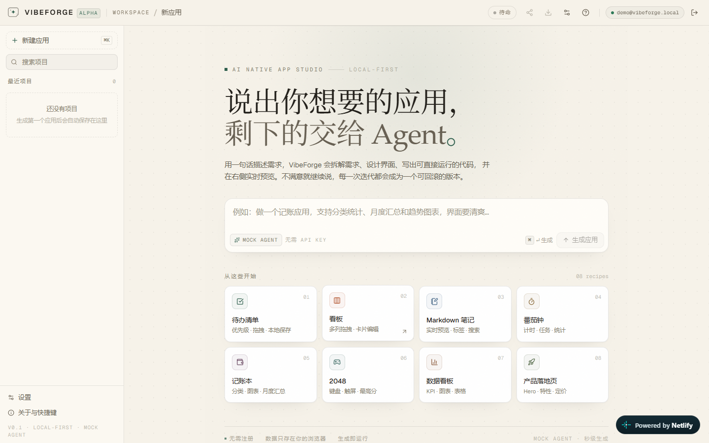
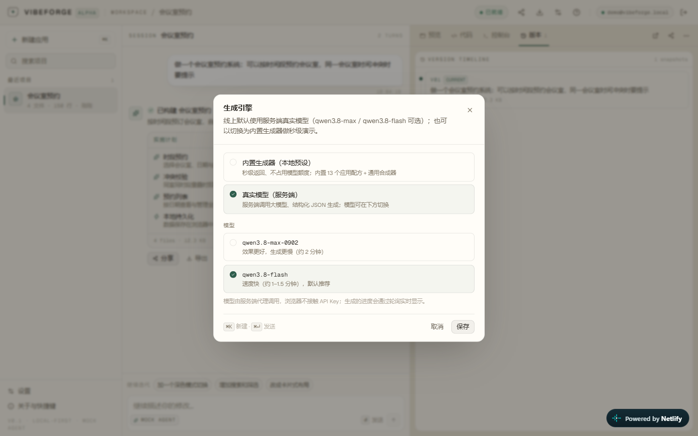

# VibeForge 操作手册（简单版）

> 🌐 在线体验：**https://vibeforge-interview-demo.netlify.app**
> 打开后先注册/登录（可用「演示账号一键体验」），**不需要自备 API Key**；线上默认是真实模型。
> 整个流程约 3 分钟（真实模型单次生成约 1–1.5 分钟）。

---

## 0. 先登录 / 注册（约 10 秒）

首次打开会进入登录页：

- **注册**：填邮箱 + 密码（至少 6 位），注册成功自动登录
- **一键体验**：点「使用演示账号一键体验」，用内置演示账号直接进入

登录后才会进入工作台；账号用于区分项目列表，密码经 PBKDF2 加盐哈希后存服务端。

> 换浏览器/设备登录同一账号会看到该账号名下的项目（项目数据保存在浏览器本地 IndexedDB）。



---

## 1. 工作台长什么样

工作台是三栏（手机上是上下两块，可切换）：

- **左边**：项目列表（当前账号生成过的应用）
- **中间**：和 Agent 的对话区（描述需求、看它干活）
- **右边**：生成结果（预览 / 代码 / 控制台 / 版本）



---

## 2. 生成第一个应用（推荐先试「会议室预约」）

两种方式任选：

**方式 A：点模板（最快，秒级）**
首页「从这些开始」区域有 8 个卡片，点任意卡片立即开始生成（走内置生成器，秒级出结果）。

**方式 B：自己描述（真实模型）**

在输入框里写需求，例如：

- `做一个会议室预约系统：可以按时间段预约会议室，同一会议室时间冲突时要提示`
- `做一个记账应用：记录收支、按分类统计、显示月度趋势图`

按 **Enter**（或点生成按钮）开始。真实模型生成时：

- 会显示「使用模型：qwen3.8-flash」和「真实模型生成中… 已输出 N 字符」的进度
- 单次约 **1–1.5 分钟**，可随时点「停止」
- 描述越具体（功能、数据、想要的感觉），结果越接近预期


> 生成失败时会出现「重试这一步」；若模型不可用，系统会自动切到内置生成器并在对话里提示。

---

## 3. 设置：真实模型 / 内置生成器

点右上角 ⚙️ 设置：

- **真实模型（默认）**：服务端调用百炼模型
  - `qwen3.8-flash`：默认，约 1–1.5 分钟
  - `qwen3.8-max-0902`：效果更强，约 2 分钟
  - 模型由服务端代理调用，浏览器不接触 API Key
- **内置生成器（本地预设）**：确定性配方 + 通用合成器，秒级返回、不消耗模型额度，适合快速演示



---

## 4. 看 Agent 干活

生成过程是**流式**的，中间区域会依次出现：

1. 「收到需求」「使用模型：…」
2. **实施计划卡**：应用名、一句话卖点、功能点、技术栈
3. **逐个文件写入**：`index.html` → `styles.css` → `app.js`（带行数/体积）
4. **自检**：结构 / 脚本语法 / 体积检查
5. 「已构建 · 应用名」

生成中可随时点输入框右侧的 **「停止」**；出错时出现 **「重试这一步」**。

---

## 5. 试玩生成的应用

生成完成后右侧自动切到「预览」：

- 可以直接在预览区**点击、输入、拖拽**（真实运行的应用，不是截图）
- 例如会议室预约应用：点空白时段新建预约、切换日期、保存时会做时间冲突校验
- 你的操作存在浏览器本地，**刷新页面也不会丢**


---

## 6. 继续修改（多轮迭代，真实模型约 1–1.5 分钟）

对结果不满意？在中间输入框继续说话，例如：

- `把标题改成「会议室预订系统」，并确认预约时间冲突时会被拦截`
- `加一个深色模式切换`
- `增加搜索和筛选`

真实模型会带上当前完整代码重写，修改可见可验证。

---

## 7. 查看代码、控制台、版本

右侧顶部有 4 个页签：

| 页签 | 用途 |
| --- | --- |
| **预览** | 试玩生成的应用（默认） |
| **代码** | 3 个文件源码，可切换文件、一键复制 |
| **控制台** | 生成应用运行时的 `console` 输出和报错 |
| **版本** | 每次生成/迭代自动快照：可**恢复**历史版本，也可**对比**当前版本逐行 diff |


---

## 8. 分享 & 导出

- **分享**：点右上角「分享」→ 复制链接 → 对方打开即可运行（链接包含完整应用）
- **导出**：`下载 HTML`（单文件，双击可开）或 `导出项目 JSON`（完整数据备份）

---

## 9. 管理项目（左侧栏）

| 操作 | 怎么做 |
| --- | --- |
| 新建应用 | 点「新建应用」，或按 **⌘K / Ctrl+K** |
| 打开历史项目 | 直接点左侧项目名 |
| 搜索项目 | 左侧搜索框输入关键词 |
| 删除项目 | 悬停项目 → 垃圾桶图标（二次确认） |

项目按账号隔离，存在当前浏览器本地（IndexedDB）；重要项目建议导出 JSON。

---

## 10. 手机 / 平板查看

- 手机上：对话与预览变成上下两块，顶部有 **「对话 / 预览」** 切换按钮
- 桌面预览区右上角可切换 **桌面 / 平板 / 手机** 三种视口


---

## 11. 常见问题

**Q：线上是真实模型吗？要自己准备 Key 吗？**
A：线上默认真实模型（qwen3.8-flash，可切 qwen3.8-max-0902），Key 配在服务端，**你不需要填 Key**；
也可以随时切「内置生成器」秒级演示。

**Q：生成要多久？**
A：真实模型约 1–2 分钟（有进度日志，可停止）；内置生成器约 5–6 秒。

**Q：打不开 / 白屏？**
A：先刷新一次；仍不行换个网络（部署在 Netlify，国内一般可直连）。

**Q：生成的应用数据存在哪？**
A：项目/版本在浏览器 IndexedDB；账号在服务端（Netlify Blobs）；生成应用自己的数据在各自 localStorage。

**Q：分享链接为什么那么长？**
A：链接里编码了完整应用代码（已 gzip 压缩）；太长时用「导出 HTML」发文件。

**Q：能生成任意应用吗？**
A：真实模型按你的需求自由设计领域（例如会议室预约会生成时间段 + 冲突校验）；
内置生成器会路由到最接近的配方或通用 CRUD 合成器。

**Q：生成失败 / 模型不可用怎么办？**
A：系统自动降级到内置生成器并在对话中提示；也可以点「重试这一步」。

**Q：怎么在本地跑？**
A：见文末「本地完整版」。

---

## 附：本地完整版（含真实模型服务端代理）

```powershell
pnpm install
cp .env.example .env.local     # 需要真实模型时填 Key（Key 只留在本地，不会提交）
pnpm dev                       # http://localhost:4311
# 或生产模式：pnpm build && pnpm start
```

本地版额外拥有：服务端真实模型代理（Key 不进前端）、`/api/generate` 流式接口，
以及全部自动化验证脚本（`pnpm test`、`scripts/*.mjs`、线上验收 `pnpm test:real`）。
